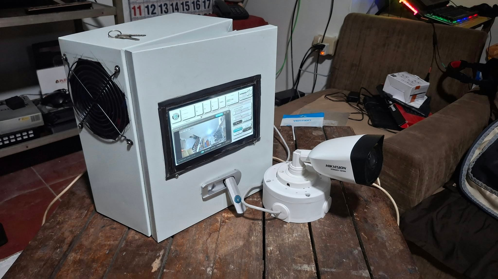
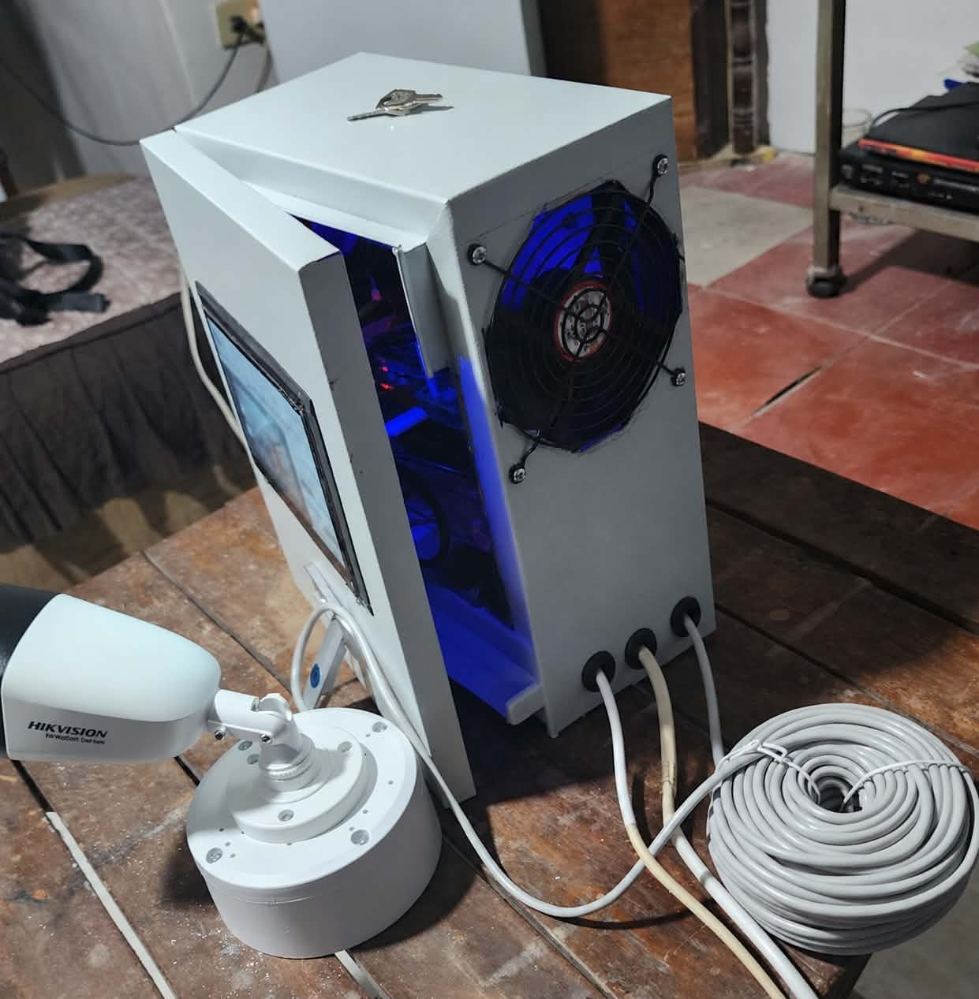
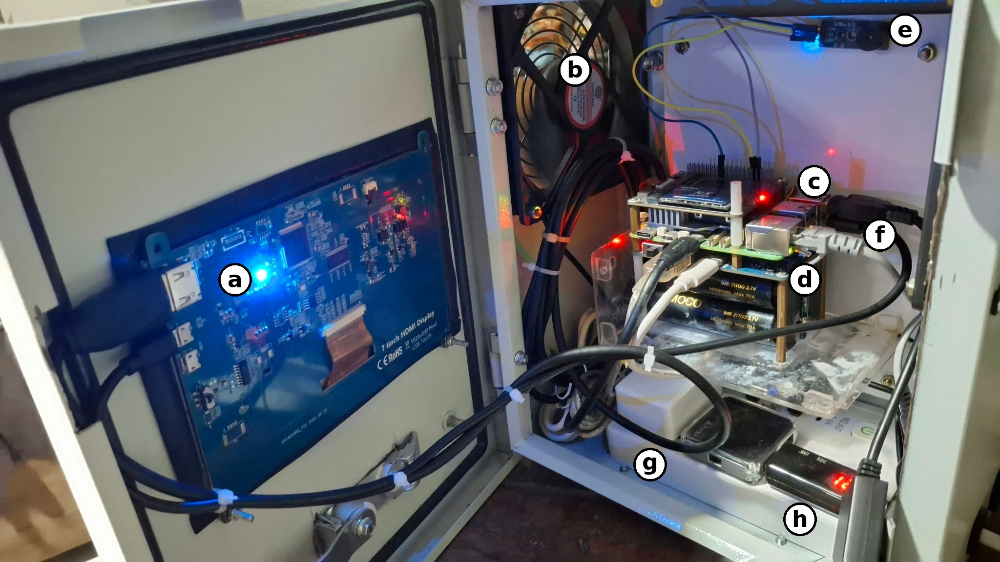
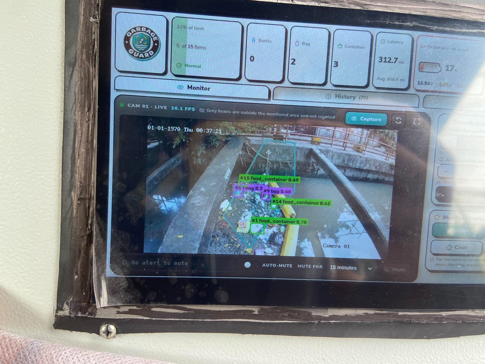
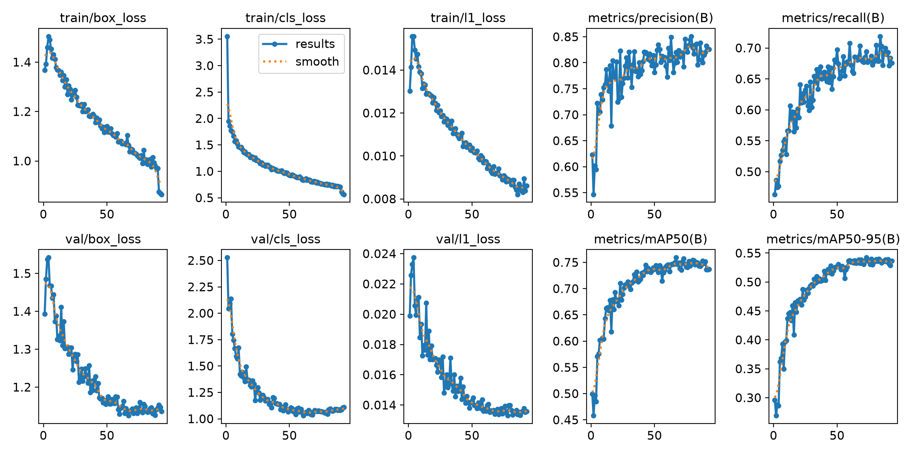
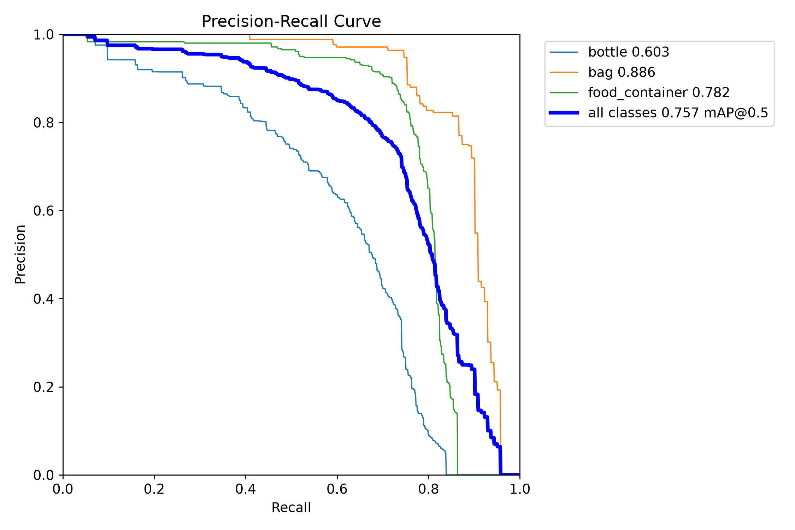
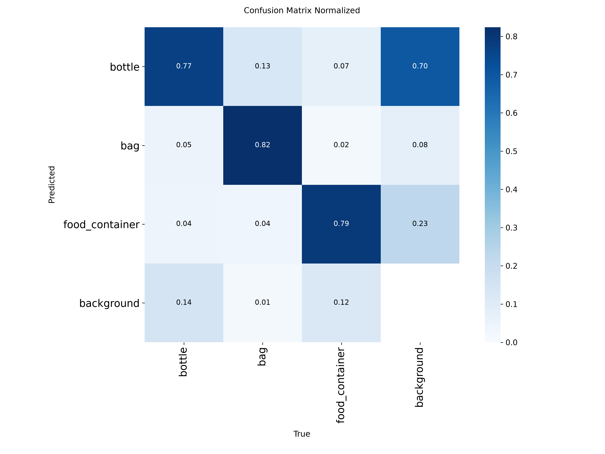

# Chapter IV Draft (working copy)

Notes for the group, not part of the chapter. Delete this box when the text moves into the manuscript.

- Outline used: 4.1 Project Description, 4.2 Project Structure, 4.3 Test Case Results (the system flow test TC_SYS_04 sits inside it), 4.4 Field Deployment Results, 4.5 Evaluation Results, 4.6 Project Capabilities and Limitations. The table of contents and Chapter V need the same change.
- Chapter III says nine training runs (v1 to v8 plus v6b). v2 was never trained, so the count is eight; Chapter III and Figure 44 need the same correction.
- Numbering starts at Figure 46 and Table 10, because v19 ends at Figure 45 and Table 9.
- Text in [square brackets] is still to be filled from the field week, the trial checklist and the survey.
- Items marked CONFIRM need a check by the group before the text is final.
- The reported model is still open (v8, or v9 due on 1 or 2 November). Section 4.3 keeps a reserved column and a reserved paragraph for it.

---

# IV. RESULTS AND DISCUSSION

This chapter presents the finished Garbage-Guard prototype and the results of the tests set out in Chapter III. Section 4.1 describes the prototype and where it was operated. Section 4.2 explains how it was built, following the path of one camera frame through the system. Section 4.3 reports the test case results for each specific objective. Section 4.4 reports the field deployment, Section 4.5 the developer-side and end-user evaluation, and Section 4.6 closes with the capabilities and limitations that the results support.

## 4.1 Project Description

Garbage-Guard is a fixed monitoring unit that watches the surface of a creek, detects floating bottles, bags and food containers, and counts how many of them are inside a monitored area drawn over the water. When the smoothed count reaches the set threshold, the unit raises an Accumulation Alert on its touchscreen dashboard, sounds its buzzer, saves a snapshot and a record, and notifies the Android application. The purpose is to tell barangay personnel when a stretch of creek needs clearing, before the waste builds up enough to block the flow.

The prototype was operated at a creek in Barangay 870, Pandacan, Manila, under the barangay testing permit in Appendix C. CONFIRM: the permit in Appendix C covers October 21, 2026, 1:00 to 3:00 PM only. The session reported below took place on October 31, 2026, and the field week will be on later dates, so the permit or a second letter has to cover them.

Figure 46 shows the assembled unit. The electronics are housed in a metal junction box with the 7-inch touchscreen set into the door, a USB case fan on each side wall and a locking handle below the screen. The Hikvision HiWatch HWI-B140H bullet camera is mounted separately on its own base and is joined to the box by its cable only.

**Figure 46**

*The Assembled Garbage-Guard Unit with the Hikvision HiWatch HWI-B140H Camera*

Figure 47 shows the side of the enclosure with the second case fan and the sealed cable entries.

**Figure 47**

*Side View of the Enclosure Showing the Case Fan and Cable Entries*

*Note.* The three cable entries, from left to right: the AC mains extension cable, the Ethernet cable to the Wi-Fi extender, and the 2-in-1 Ethernet and power cable to the camera. The coil in the foreground is the camera cable.

Figure 48 shows the inside of the enclosure with each part labelled.

**Figure 48**

*Inside of the Enclosure with the Main Parts Labelled*

*Note.* (a) Back of the 7-inch 1024 x 600 HDMI touchscreen, mounted on the door; (b) USB fan; (c) board stack, from top to bottom: NVMe HAT, Raspberry Pi 5 with the Active Cooler, and Waveshare UPS HAT (E); (d) the four 21700 lithium-ion cells of the UPS HAT (E); (e) passive buzzer module; (f) 2-in-1 Ethernet and power cable to the camera; (g) official Raspberry Pi 27 W (5.1 V, 5 A) power adapter, plugged into the AC mains extension; (h) 5 V to 12 V USB to DC barrel jack step-up cable for the camera, connected to a USB hub.

During the session on October 31, 2026, the unit ran from 11:30 AM to 1:00 PM in sunny weather with normal daylight. Figure 49 shows the touchscreen during that session, with the monitored area drawn over the water and detections labelled by class, identity number and confidence.

**Figure 49**

*The Touchscreen Dashboard During the Field Session at the Creek*

*Note.* The date stamped in the camera image reads 01-01-1970 because the camera clock was not set on site. The Raspberry Pi keeps its own clock, so the records in the database carry the correct time. CONFIRM: set the camera clock before the field week so later figures show the right date.

## 4.2 Project Structure

The structure is explained by following one camera frame from the moment it is captured to the moment its result appears on the phone. The parts are the camera, the Raspberry Pi 5, the detection stage, the accumulation and alert stage, the database, the touchscreen dashboard, the Firebase link and the Android application. The overall layout is the system architecture shown in Figure 26 of Chapter III.

**Camera**

The Hikvision HiWatch HWI-B140H sends its video over RTSP through an Ethernet cable connected directly to the Raspberry Pi 5. The camera is powered from the UPS HAT through a USB hub, a 5 V to 12 V step-up cable and a 2-in-1 Ethernet and power cable, so the camera and the Raspberry Pi share one battery. The camera has two streams. The main stream, used for detection, was set to 1280 x 720 at 15 frames per second with H.264 encoding. The sub-stream, at 640 x 360, is kept as a fallback. The main stream at 1920 x 1080 was also tried, but the Raspberry Pi could not decode it fast enough and the picture fell six to seven seconds behind, so 1280 x 720 was chosen. At that setting the picture on the touchscreen was about one second behind the scene.

**Raspberry Pi 5**

The Raspberry Pi 5 runs Raspberry Pi OS (64-bit) and the Garbage-Guard program, written in Python with OpenCV. A separate reading thread keeps only the newest frame, so the detector never works on a backlog of old frames. If no frame arrives for 12 seconds the camera is reconnected, and if the main stream gives no picture twice in a row the program switches to the sub-stream on its own and shows a note on the dashboard. Internet access, needed for Firebase, comes through a USB-to-Ethernet adapter cabled to a Wi-Fi repeater, because the built-in Wi-Fi of the board could not join any network during testing.

**Detection**

Each frame is cropped to the box around the monitored area, with a small margin, before it reaches the model. Only that part of the picture is passed to YOLO26n, exported to NCNN for the Raspberry Pi, at a detection size of 960 pixels. Cropping keeps small items in the water large enough to detect and spends no processing time on the banks. ByteTrack gives each detected item an identity that stays the same while the item is in view, and the dashboard shows it as a short number next to the class name and the confidence.

**Accumulation and alert**

An item is counted when the centre of its box lies inside the monitored area. To keep a single missed or extra detection from causing a false alarm, the count used for the alert is the median of the last 15 frames. The Accumulation Alert is raised once when this smoothed count reaches the threshold. It is not raised again until the count has fallen back to the re-arm level, which is the threshold minus a quarter of it, rounded down (15 for the default threshold of 20, 12 for a threshold of 15), and at least 60 seconds have passed. A short spike that never lasts long enough to raise the alert is recorded as a suppressed event. The threshold is not fixed: it can be changed on the dashboard and in the application, so it can be calibrated to the size of each site. During the October 31 session it was set between 10 and 15 items (CONFIRM the final calibrated value). When the alert is raised, the passive buzzer sounds and repeats until it is muted, except during the quiet hours set on the dashboard.

**Database**

Every alert, suppressed event, manual capture, test alert, mute and power event is written to a local SQLite database with its time, the count per class, the peak confidence, the threshold in use and the path of its snapshot. Each snapshot is saved with the boxes, the monitored area and an information card, and a clean copy without markings is saved beside it for labelling future training data. Every 100 frames the program also writes the mean, median and maximum latency to the database, which is the source of the latency results in Section 4.4.

**Touchscreen dashboard**

The dashboard is a local web page served by the Raspberry Pi on port 8080 and shown full screen on the 7-inch touchscreen. It has three tabs. Monitor shows the live picture with the detections, the count per class against the threshold, the latency, the battery level and the alert state, with buttons to capture a snapshot and to mute the alert. The monitored area is drawn here by tapping points around the water. History lists the stored events with filters by event type and date and opens each snapshot. Settings holds the screen saver, power and automatic shutdown, buzzer and quiet hours, camera stream and model options.

**Firebase**

When a phone is not on the same network as the Raspberry Pi, the two communicate through a Firebase Realtime Database. The Raspberry Pi uploads its state, the history and compressed snapshots, and reads the commands the application leaves there, such as muting the alert. Uploads are kept small and slowed down when no phone is watching, so the free monthly allowance of Firebase is not exceeded.

**Android application**

The application connects to the Raspberry Pi directly on the local network, or through Firebase when it is away from it. It receives the Accumulation Alert as a notification with its own sound and vibration, shows the live picture, the history and the snapshots, and can mute the alert, change the detection settings and shut the Raspberry Pi down safely.

Figures 50 to 55 show the screens that satisfy each requirement. The complete set of screens is in Appendix G.

**Figure 50**

*Monitor Tab of the Touchscreen Dashboard with Live Detections (TC_SYS_05)*

[Insert the screenshot from Figure G1.]

**Figure 51**

*Dashboard During an Accumulation Alert (TC_SYS_02, TC_SYS_09)*

[Insert the screenshot from Figure G2.]

**Figure 52**

*Drawing the Monitored Area on the Dashboard (TC_SYS_06)*

[Insert the screenshot from Figure G3 or G4, after the fullscreen drawing update.]

**Figure 53**

*History Tab with the Stored Alerts and Snapshots (TC_SYS_08)*

[Insert the screenshot from Figure G6.]

**Figure 54**

*Settings Tab with the Threshold, Camera Stream and Model Options (TC_SYS_10)*

[Insert the screenshot from Figure G9, updated to show the Camera stream and Model cards.]

**Figure 55**

*Accumulation Alert Notification on the Android Application (TC_SYS_09)*

[Insert the screenshot from Figure G20.]

## 4.3 Test Case Results

The results are reported per specific objective, in the order of Section 1.2.

### Objective 1: Detection Performance of the YOLO26n Model

**Training history**

Eight training runs were carried out before the field week: v1, v3, v4, v5, v6, v6b, v7 and v8. The dataset for v2 was assembled but not trained, because v3 replaced it. Table 10 lists every run with the change that defined it and its scores on its own test set.

**Table 10**

*Training Runs of the YOLO26n Model and Their Test Results*

| Run | Main change from the previous run | Test images | Precision | Recall | mAP@0.5 |
|---|---|---|---|---|---|
| v1 | Three public datasets, first proper train, validation and test split | 310 | 0.893 | 0.636 | 0.703 |
| v2 | Second bottle source added (assembled, not trained) | – | – | – | – |
| v3 | More bottle variety and TACO food containers | 357 | 0.828 | 0.655 | 0.708 |
| v4 | Class names generalized, more public data for all classes | 377 | – | – | 0.687 |
| v5 | 188 hand-labelled creek images added | 641 | 0.863 | 0.685 | 0.761 |
| v6 | Creek images increased to 934, training moved to a local RTX 2070 | 397 of 509 | 0.831 | 0.729 | 0.783* |
| v6b | Styrofoam labels repaired and capped at 400 images | 441 | 0.824 | 0.683 | 0.754 |
| v7 | Test partition frozen at 20% of the data | 807 | 0.852 | 0.685 | 0.745 |
| v8 | Relabelled creek set, new bag images, field captures, trained at 960 px | 807 | 0.829 | 0.674 | 0.728 |
| v9 | [Reserved] | [ ] | [ ] | [ ] | [ ] |

*Note.* The scores of v1 to v6b are not directly comparable with each other or with v7 and later, because each of those runs had a different test set. v7 and v8 use the same frozen test set of 807 images. v8 is shown at its training size of 960 pixels. *The v6 score is not valid: its data loader silently skipped all 1,092 styrofoam images in every split.

The first run, v1, combined three public datasets into the three classes and gave a mAP@0.5 of 0.703, with bags almost perfectly detected and bottles the weakest class. v3 added bottles from more varied scenes and a small number of food containers from TACO. Bottle recall rose from 0.429 to 0.492, but the overall score barely moved (0.708), which showed that more public data was giving smaller and smaller returns.

v4 renamed the classes from plastic-specific labels to bottle, bag and food container and took every usable image from TACO. The overall score fell to 0.687, because paper and carrier bags from TACO made the bag class less consistent. Public data had stopped helping, which led the researchers to collect their own creek images.

v5 was the first run with real creek images: 188 photographs taken and labelled by the researchers. The overall score rose to 0.761, and the two classes that received creek images, bottles and food containers, were the two that improved. This confirmed that images matching the deployment site mattered more than the amount of public data.

v6 increased the creek images to 934 and scored 0.783, but only 397 of its 509 test images loaded. The investigation found that every styrofoam image had been dropped because its label files mixed box and polygon lines, so the v6 score was not valid. v6b repaired those labels and capped the styrofoam source at 400 images. It scored 0.754 on a complete test set, which was a lower but honest result.

The rebuild for v6b also showed that rebuilding the dataset moved some test images into training. For v7 the test partition was therefore fixed once at 20% of the data, as the adviser required, and never rebuilt. v7 scored a precision of 0.852, a recall of 0.685 and a mAP@0.5 of 0.745 on 807 test images. It is the model whose scores are reported in the rest of this objective, unless the reported-model paragraph below says otherwise.

v8 replaced the old creek images with a relabelled set, added new bag images and images captured by the prototype itself, and was trained at 960 pixels to match the detection size on the Raspberry Pi. On the same frozen test set it scored slightly below v7 (mAP@0.5 of 0.728 against 0.745) and clearly below it on the creek-only images (0.497 against 0.593), while bags at the creek stayed at about 0.17 for both models. The likely reason is that v8 had fewer images resembling the old creek test photographs, since many of them were left out to keep the test set separate. The frozen test set is made of older phone photographs and does not show the sharper 1280 x 720 picture the prototype now uses, so the field results in Section 4.4 are needed to decide between the models.

[Reserved paragraph for v9: what changed, its results on the frozen test set and the creek-only images, and whether it replaced v7 as the reported model.]

**Results of the reported model**

Table 11 gives the per-class results on the frozen test set of 807 images and on its 180 creek images.

**Table 11**

*Per-Class Detection Results on the Frozen Test Set and on the Creek Images*

| Test set | Class | v7 Precision | v7 Recall | v7 mAP@0.5 | v8 Precision | v8 Recall | v8 mAP@0.5 | [Reported model] |
|---|---|---|---|---|---|---|---|---|
| Full (807) | All classes | 0.852 | 0.685 | 0.745 | 0.829 | 0.674 | 0.728 | [ ] |
| Full (807) | Bottles | 0.808 | 0.558 | 0.647 | 0.772 | 0.556 | 0.629 | [ ] |
| Full (807) | Bags | 0.899 | 0.787 | 0.815 | 0.854 | 0.803 | 0.816 | [ ] |
| Full (807) | Food containers | 0.861 | 0.709 | 0.774 | 0.861 | 0.662 | 0.739 | [ ] |
| Creek (180) | All classes | 0.742 | 0.534 | 0.593 | 0.567 | 0.499 | 0.497 | [ ] |
| Creek (180) | Bottles | 0.832 | 0.610 | 0.729 | 0.601 | 0.505 | 0.509 | [ ] |
| Creek (180) | Bags | 0.500 | 0.217 | 0.179 | 0.248 | 0.261 | 0.174 | [ ] |
| Creek (180) | Food containers | 0.895 | 0.775 | 0.871 | 0.851 | 0.732 | 0.807 | [ ] |

*Note.* v7 at 640 pixels and v8 at 960 pixels, each at the size it was trained at. The v7 overall row uses the official evaluation; its per-class rows come from the later comparison run, whose overall precision differed by 0.004 (0.856).

Precision is the measure read against the Table 3 scale, following the 80% target in Section 1.3, with recall and mAP@0.5 reported beside it. On the full test set v7 reached a precision of 85.2%, which falls in the Good band (80% to 89.99%) and meets the 80% target. On the creek images alone its precision was 74.2%, in the Fair band. The difference between the two sets is expected, because the creek images are harder: items are smaller, partly submerged and mixed with leaves and other debris. Nunkhaw et al. (2025) reported the same kind of gap between controlled and field conditions for floating waste in urban canals.

Recall was lower than precision in every class. In plain terms, when the model marks an item it is usually right, but it misses some items altogether. Since missed items are not counted, the system is more likely to count too few items than too many, so an alert may come later than it would with a perfect detector, but rarely too early. Bags at the creek were the weakest result, with a recall of 0.217 on 20 test images, and food containers were the strongest (mAP@0.5 of 0.871).

The precision of 85.2% on the full test set is close to the 85.9% reported by Nežerka et al. (2023) for camera-based recognition of waste fragments, although their task was classification of single fragments rather than detection in a moving scene.

Figures 56 to 58 show the training curves, the precision-recall curve and the normalized confusion matrix of the reported model.

**Figure 56**

*Training and Validation Curves of the v7 Model*

**Figure 57**

*Precision-Recall Curve of the v7 Model*

**Figure 58**

*Normalized Confusion Matrix of the v7 Model*

The training curves in Figure 56 show the losses falling steadily and the validation mAP@0.5 levelling off at about 0.75 after epoch 60. Training stopped early at epoch 93 of 100, after 20 epochs without improvement, and took 1.37 hours on an RTX 2070. The confusion matrix in Figure 58 shows that 82% of bags, 79% of food containers and 77% of bottles were classified correctly, and that bottles were the class most often missed (14% predicted as background). It also shows that 70% of the false detections on background were labelled as bottles, which is the main source of false alarms.

[If v9 or v8 becomes the reported model, replace Figures 56 to 58 with its own curves and update the paragraphs above.]

Table 12 gives the unit test results.

**Table 12**

*Unit Testing Results*

| Test Case ID | Objective | Expected Result | Actual Result | Successful Trials / 10 |
|---|---|---|---|---|
| TC_UNIT_01 | Evaluate classification precision, recall and mAP@0.5 | Precision of at least 0.80, with recall and mAP@0.5 indicated for each class | Precision 0.852, recall 0.685, mAP@0.5 0.745 on 807 test images (Table 11). Pass. | One evaluation run (not counted in trials) |
| TC_UNIT_02 | Validate the accumulation counter logic | Alert raised once at the 20-item threshold and not again until the count falls to 15 | [The 19 automated counter tests passed; record the 10 simulated runs] | [ ] |
| TC_UNIT_03 | Verify the performance efficiency logging | Latency is calculated without the hardware crashing | [Latency summaries written every 100 frames; record the 10 runs] | [ ] |

### Objective 2: Operation of the Raspberry Pi 5 Prototype

Table 13 gives the system test results from the field.

**Table 13**

*System Testing Results*

| Test Case ID | Objective | Actual Result | Successful Trials / 10 |
|---|---|---|---|
| TC_SYS_01 | Real-world object detection | [ ] | [ ] |
| TC_SYS_02 | Real-time accumulation alert | [ ] | [ ] |
| TC_SYS_03 | Real-time processing latency | [ ] | [ ] |
| TC_SYS_04 | System flow (end to end) | [See the system flow test below] | [ ] |
| TC_SYS_05 | Live dashboard | [ ] | [ ] |
| TC_SYS_06 | Region of interest | [ ] | [ ] |
| TC_SYS_07 | Stable tracking and count | [ ] | [ ] |
| TC_SYS_08 | Event storage | [ ] | [ ] |
| TC_SYS_09 | Alert delivery | [ ] | [ ] |
| TC_SYS_10 | Threshold setting | [ ] | [ ] |

During the October 31 session, most detections were bottles, bags and food containers correctly labelled. The floating barrier across the creek was at first detected as an item. Redrawing the monitored area so that it excluded the barrier removed these false detections, which is the purpose of the region of interest tested in TC_SYS_06.

**System flow test**

[One paragraph and one screenshot per step of Figure 28: unit switched on, camera feed shown, items placed in the monitored area, count rising, threshold reached, alert shown with the buzzer, record saved in History, notification on the application.]

## 4.4 Field Deployment Results

[Chapter III plans about a week at the creek, at least four to five days. If the actual deployment is shorter, Chapter III must be updated to match.]

**Table 14**

*Field Deployment Log*

| Date | Time | Hours | Model and detection size | Camera stream | Threshold | Weather | Crashes or overheating |
|---|---|---|---|---|---|---|---|
| October 31, 2026 | 11:30 AM to 1:00 PM | 1.5 | v8, 960 px | Main, 1280 x 720, 15 fps | 10 to 15 (CONFIRM) | Sunny | [ ] |
| [ ] | [ ] | [ ] | [ ] | [ ] | [ ] | [ ] | [ ] |

[Latency: mean, median and maximum per day from the latency records, converted from milliseconds to seconds and read against the Table 3 scale.]

The latency is measured from the moment a decoded camera frame reaches the program to the moment detection and tracking of that frame are finished, as defined in Equation 5. It does not include the camera's own encoding and network delay, which added about one second between the scene and the touchscreen. During the October 31 session the dashboard showed an average of about 309 ms (0.31 s) per frame with v8 at 960 pixels, which falls in the Excellent band (below 0.5 s). [Replace with the logged figures.] In bench tests with the main stream at 1280 x 720, the median latency was 186 to 191 ms with about five frames processed per second, and the processor stayed at 68 °C without throttling. Running a remote screen-sharing session on the Raspberry Pi at the same time raised the median to about 405 ms, so all reported latencies were measured without screen sharing. Li et al. (2024) reported 33 frames per second for a very small YOLO model on an edge device. Garbage-Guard processes fewer frames per second, which is adequate for this task because floating waste moves slowly and the count is smoothed over 15 frames, about three seconds.

**Table 15**

*Threshold Calibration Record*

| Date and time | Hand count in the monitored area | Dashboard count | Difference | Threshold after adjustment |
|---|---|---|---|---|
| [ ] | [ ] | [ ] | [ ] | [ ] |

## 4.5 Evaluation Results

**Developer-side evaluation**

**Table 16**

*Developer-Side Internal Acceptance Results*

| Indicator Code | Evaluation Statement (Table 7) | Result | Table 3 Rating |
|---|---|---|---|
| DEV-FS1 | Accurate detection of the three classes, ignoring sunken debris and organic matter | [ ] | [ ] |
| DEV-FS2 | Accumulation Alert raised when the threshold is reached | [ ] | [ ] |
| DEV-PE1 | Latency below 3.0 seconds per frame | [ ] | [ ] |
| DEV-PE2 | Continuous operation without crashing or overheating | [ ] | [ ] |

**End-user evaluation**

[Number of respondents, who they were, and when they answered. The weighted mean of each statement is computed with the formula in Chapter III and read against Table 9.]

**Table 17**

*End-User Usability Survey Results*

| Indicator Code | Evaluation Statement (Table 8) | Weighted Mean | Interpretation |
|---|---|---|---|
| USR-U1 | Information on the monitor is easy to read and understand | [ ] | [ ] |
| USR-U2 | Bounding boxes clearly show where the garbage is | [ ] | [ ] |
| USR-U3 | The Accumulation Alert is clear and noticeable | [ ] | [ ] |
| USR-U4 | The system gives helpful insights for monitoring | [ ] | [ ] |
| USR-U5 | The application matches the touchscreen | [ ] | [ ] |
| | Overall | [ ] | [ ] |

## 4.6 Project Capabilities and Limitations

**Capabilities**

- Detects bottles, bags and food containers with a precision of 85.2% on the frozen test set of 807 images, meeting the 80% target (Section 4.3).
- Counts only the items inside the monitored area. Redrawing the area removed false detections of the floating barrier at the creek (Section 4.3).
- Raises one Accumulation Alert per build-up, with smoothing over 15 frames and a re-arm level that prevents repeated alarms (TC_UNIT_02).
- Processes frames in about 0.2 to 0.3 seconds on the Raspberry Pi 5 (Excellent band), with the picture about one second behind the scene (Section 4.4).
- Stores every event with a snapshot, shows it on the touchscreen and the application, and reaches the application away from the local network through Firebase.
- Runs on its UPS battery, shows the remaining charge and shuts down safely before the battery runs out.
- Lets the threshold, detection size, camera stream and model be changed from the dashboard, without editing code.

**Limitations**

- Bags at the creek are rarely detected: a recall of 0.217 on 20 test images. Piles with many bags will be undercounted.
- Recall is lower than precision in every class, so the count tends to be too low rather than too high. About four in ten bottles at the creek are missed.
- Precision on creek images (74.2%) is lower than on the full test set (85.2%).
- Most false detections are labelled as bottles. Fixed objects in the water, such as the floating barrier, must be kept outside the monitored area.
- The enclosure is no longer IP65 after the cut-outs for the screen, fans and cables, so the unit has to be placed under cover.
- [Fans on battery: CONFIRM what happens to the case fans when the unit runs on battery, as noted in the v16 placeholder.]
- The built-in Wi-Fi of the Raspberry Pi 5 did not work during testing, so internet access depends on a cabled Wi-Fi repeater.
- The camera clock resets when the camera loses power, so the date stamped in the video can be wrong. The records use the Raspberry Pi's clock and are not affected.
- [Field results that limit the system, such as lighting, distance or crowded water.]

---

Main findings for Chapter V (to be confirmed after the field week)

1. The model met the 80% precision target on the frozen test set (85.2%, Good), but reached 74.2% (Fair) on creek images, with bags as the weakest class.
2. Images from the deployment site improved the model more than additional public data (v4 against v5).
3. Cropping the main stream to the monitored area allowed small items to be detected at an average latency of about 0.2 to 0.3 seconds per frame (Excellent).
4. The region of interest removed false detections of fixed objects such as the floating barrier.
5. [Alert success rate, uptime and usability results from the field week.]
