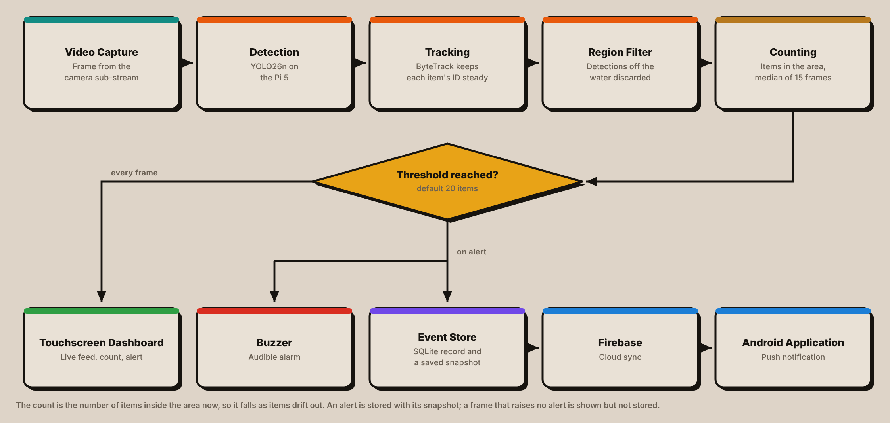
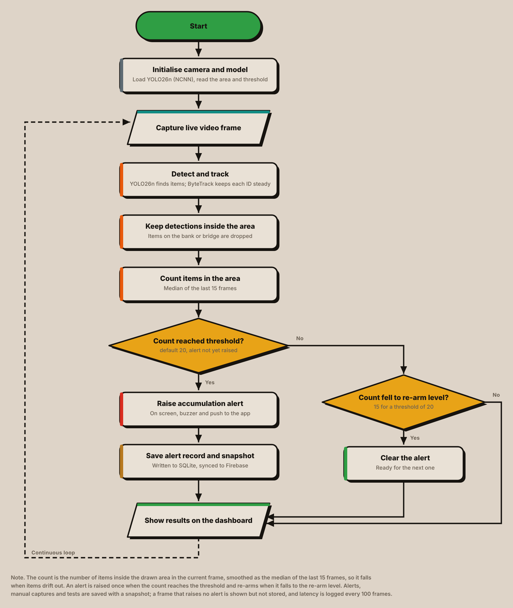

# Documents

Every thesis document of the Garbage-Guard capstone: the manuscript, the
defense deck, the patent draft, the figures and the cited sources.

## The manuscript

The manuscript is kept as numbered Word files with a PDF beside each,
`Garbage-Guard v<n>.docx` and `.pdf`. The highest number is the final
version, **v87**. Earlier versions stay in the repository's history.

After opening the .docx, right-click the table of contents and the lists of
figures and tables and choose **Update Field**.

## What is in this folder

| Item | What it is |
|---|---|
| `Garbage-Guard v87.docx`, `Garbage-Guard v87.pdf` | The final manuscript, Chapters I to V with Appendices A to J |
| `Garbage-Guard Final Defense v6.html`, `.pdf` | The final defense slide deck |
| `Garbage-Guard Patent Draft v4.pdf` | The patent draft |
| [`Figures/`](Figures/) | The diagrams in the manuscript, each as an HTML source and a PNG, plus the folders below |
| [`Figures/Components/`](Figures/Components/) | Photos of the parts and of the finished prototype |
| [`Figures/Screenshots/`](Figures/Screenshots/) | Dashboard, app and deployment images taken from the manuscript for the home README |
| [`Figures/Logos/`](Figures/Logos/) | Software and school logos |
| [`Figures/Sources/`](Figures/Sources/) | Images taken from cited studies |
| [`References/`](References/) | A copy of every cited source, named `(Author, Year)`. [`index.md`](References/index.md) lists them |
| `THESIS FILES.url` | Shortcut to the group's shared Drive folder |

Each image folder has its credits in `sources.txt`.

## The diagrams

| Diagram | File |
|---|---|
| Conceptual framework | `GarbageGuard_Conceptual_Framework` |
| Block diagram | `GarbageGuard_Block_Diagram` |
| System architecture | `GarbageGuard_System_Architecture` |
| System flowchart | `GarbageGuard_System_Flowchart` |
| Enclosure drawing | `GarbageGuard_Enclosure_Drawing` |
| Model training and deployment pipeline | `GarbageGuard_Training_Pipeline` |
| V-Model | `GarbageGuard_V_Model` |
| Gantt chart (Appendix A) | `GarbageGuard_Gantt_Chart` |

Edit the `.html` file, open it in a browser, and take a fresh PNG of it to
update a figure.

## Technical documents kept beside the code

These describe the system itself, so they stay next to the code they
explain. The paper draws on them.

| Document | Covers |
|---|---|
| [`Raspberry Pi 5/README.md`](../Raspberry%20Pi%205/README.md) | Running the system on the Raspberry Pi, and its tests |
| [`Raspberry Pi 5/GarbageGuard_Field_Reference.md`](../Raspberry%20Pi%205/GarbageGuard_Field_Reference.md) | Setting up and calibrating at the creek site |
| [`Mobile App/GarbageGuard_API.md`](../Mobile%20App/GarbageGuard_API.md) | Every API endpoint the dashboard and the app use |
| [`Mobile App/FIREBASE.md`](../Mobile%20App/FIREBASE.md) | How the app reaches the Pi through Firebase |
| [`Mobile App/README.md`](../Mobile%20App/README.md) | Building and installing the Android app |
| [`CHANGELOG.md`](../CHANGELOG.md) | What changed in each version |
