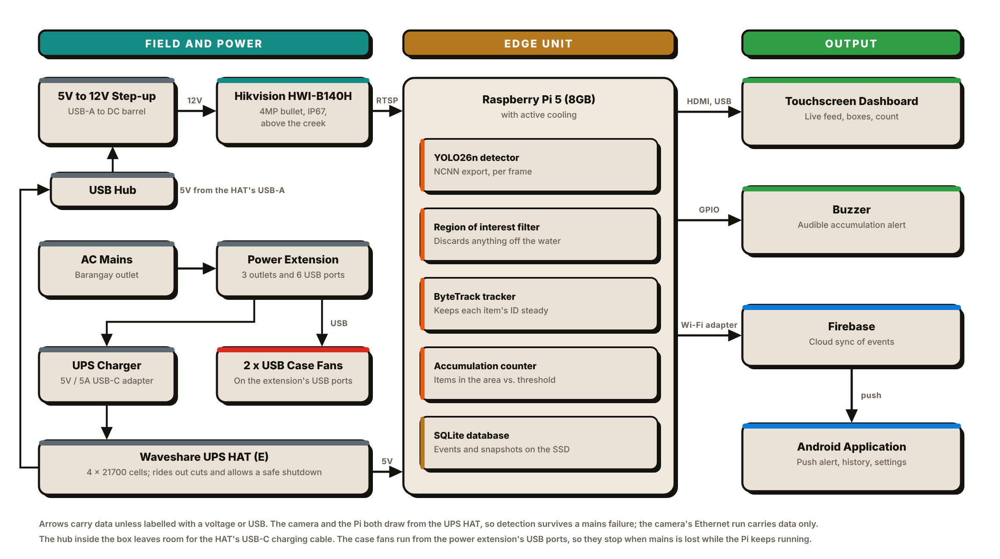
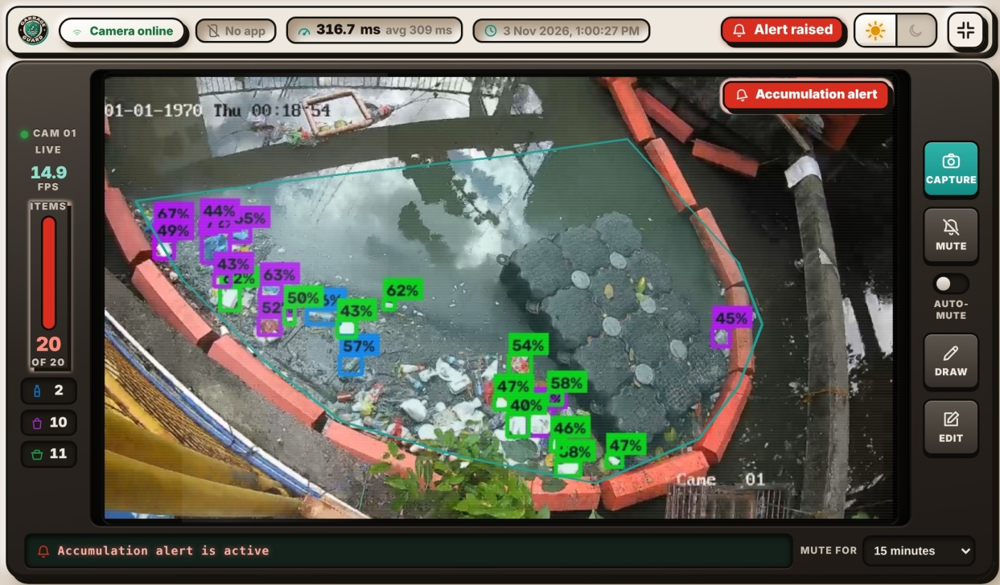
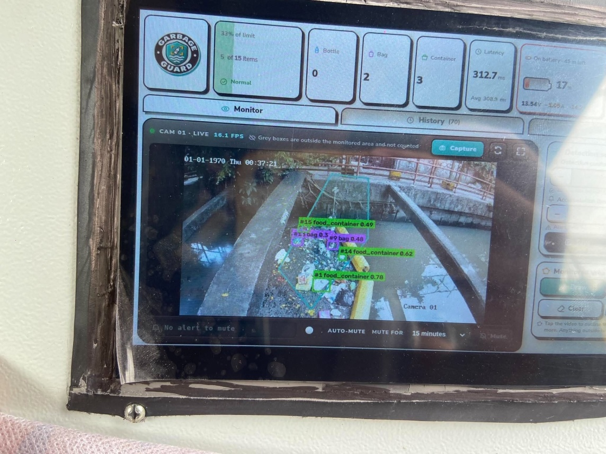
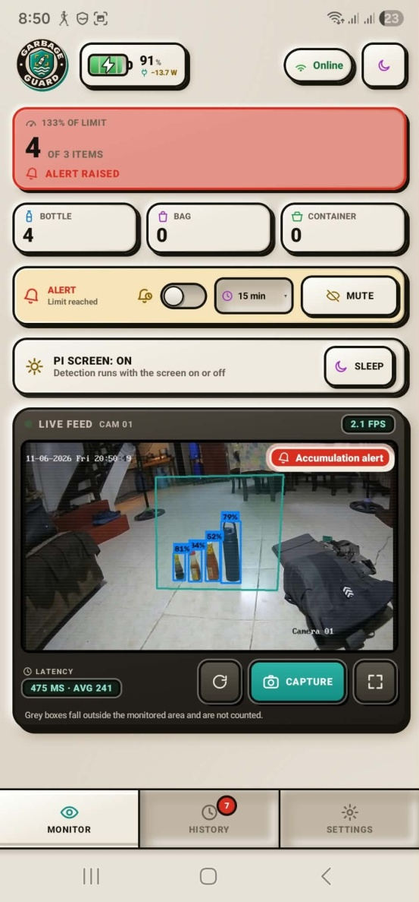
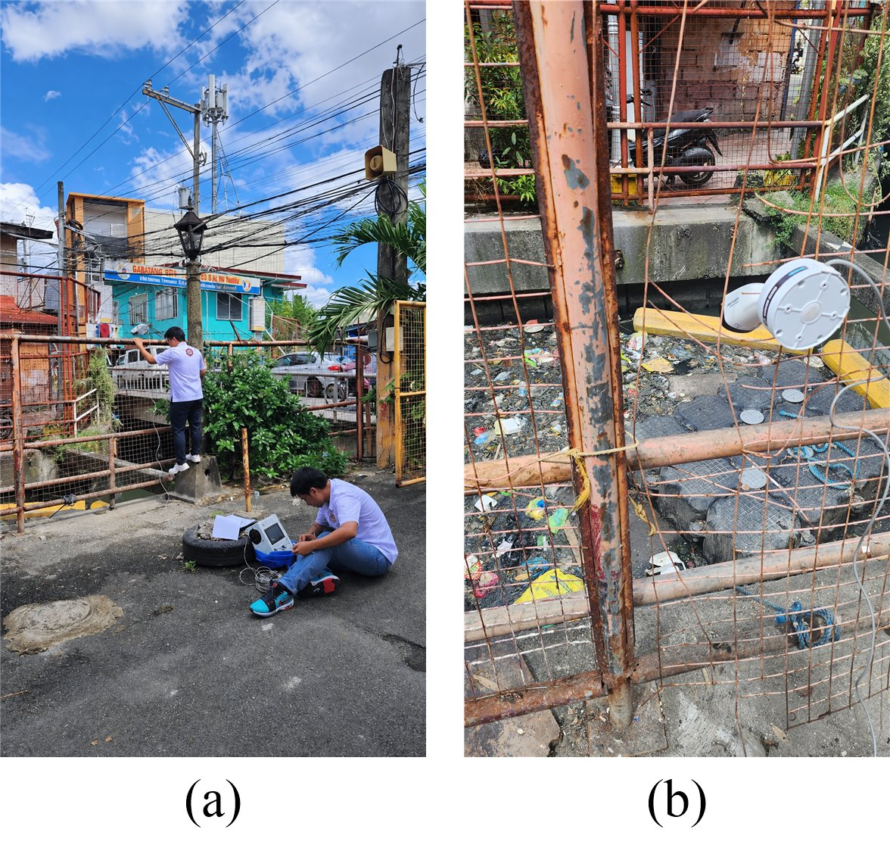

# Garbage-Guard

**Development of Computer Vision for Creeks Garbage Detection Using
Convolutional Neural Network**

Capstone study, Bachelor of Engineering Technology major in Computer
Engineering Technology, Electronics Engineering Technology Department,
College of Industrial Technology, Technological University of the
Philippines Manila. November 2026.

Garbage-Guard is a fixed unit that watches a stretch of creek and counts the
floating garbage in it. A YOLO26n model running on a Raspberry Pi 5 detects
bottles, bags and food containers in the camera feed, ByteTrack keeps one
identity per item, and only items inside an operator-drawn area of water are
counted. When the count, smoothed over 15 frames, reaches the threshold, the
unit raises an Accumulation Alert on its touchscreen, sounds a buzzer, and
notifies the Android app.

The unit was operated at a creek in Barangay 870, Pandacan, Manila, under
barangay testing and deployment permits.

## How it works

1. **Camera.** A Hikvision HiWatch HWI-B140H sends its main stream
   (1280x720, 15 fps, H.264) over RTSP on an Ethernet cable straight to the Pi.
2. **Detection.** Each frame is cropped to the box around the monitored area
   and passed to YOLO26n, exported to NCNN, at 960 px.
3. **Tracking and counting.** ByteTrack keeps each item's ID steady across
   frames. Items outside the monitored area are ignored. The count is the
   median of the last 15 frames.
4. **Alert.** At the threshold (20 by default, set per site) the alert fires
   once. It re-arms only after the count drops to the re-arm level (15 for
   a threshold of 20) and 60 seconds have passed.
5. **Storage and sync.** Every event goes into a local SQLite database with a
   snapshot and a clean copy of the frame. `gg_cloud.py` mirrors state,
   history and compressed snapshots to Firebase Realtime Database for phones
   away from the site.

The camera and the Pi both run from a Waveshare UPS HAT (E), so detection
keeps going through a mains outage and the Pi shuts itself down cleanly
before the battery runs flat. Internet for Firebase comes from a USB Wi-Fi
adapter outside the enclosure, because the Pi's built-in Wi-Fi could not join
a network during testing.

## The touchscreen dashboard and the app

The dashboard is a local web page served by the Pi on port 8080
(`gg_web.py`, Python's built-in `http.server`) and shown full screen on the
7-inch touchscreen. It has three tabs: Monitor, History and Settings.

  
  

The Android app (Kotlin, Jetpack Compose) reads the same API as the
dashboard. On the same network it talks to the Pi directly; away from it, it
goes through Firebase. It receives the alert as a notification with its own
sound, shows the live picture, history and snapshots, and can mute the alert,
change the detection settings, and shut the Pi down safely.

## Results

From Chapter IV of the manuscript. The reported model is v10, the last of
ten training runs.

| Measure | Result |
|---|---|
| Precision, frozen test set of 807 images | 84.6% |
| Recall, frozen test set | 67.2% |
| mAP@0.5, frozen test set | 0.744 |
| Processing time per frame on the Pi (deployment days) | 275 to 350 ms |
| Operation at the creek | 24 hours over six days, no crash, freeze or overheating |
| Accumulation Alert | Triggered in all 10 trials |
| Live classification accuracy (three deployment days) | 74.7%, rising to 85.0% after the camera was lowered to about 7 ft |
| Interaction Capability (end-user survey, ISO/IEC 25010:2023) | 4.40, Excellent |

Recall is lower than precision, so the unit tends to count too few items
rather than too many. The threshold should be set from a hand count at each
site. Plastic bags at the creek are the weakest class.

## What is in this repository

| Folder | Contents |
|---|---|
| [`Raspberry Pi 5/`](Raspberry%20Pi%205/) | The system: detection engine, counter, web server and dashboard, Firebase sync, buzzer, UPS readout, power and screen handling, and their unit tests. Start with its [README](Raspberry%20Pi%205/README.md). |
| [`Mobile App/`](Mobile%20App/) | The Android Studio project, the installable APK, a mock server with the same API as the Pi, the API reference and the Firebase guide. Start with its [README](Mobile%20App/README.md). |
| [`Documents/`](Documents/) | The manuscript, the final defense deck, the patent draft, and the team's figures. See its [README](Documents/README.md). |
| [`CHANGELOG.md`](CHANGELOG.md) | What changed in each version of the Pi software and the app. |

## Quick links

| I want to... | Go to |
|---|---|
| Read the thesis | [`Documents/Garbage-Guard v87.pdf`](Documents/Garbage-Guard%20v87.pdf) |
| Run the system on the Pi | [`Raspberry Pi 5/README.md`](Raspberry%20Pi%205/README.md), "Running it" |
| Set up and calibrate at the creek | [`Raspberry Pi 5/GarbageGuard_Field_Reference.md`](Raspberry%20Pi%205/GarbageGuard_Field_Reference.md) |
| Install the app on a phone | [`Mobile App/Garbage-Guard v15.apk`](Mobile%20App/Garbage-Guard%20v15.apk) |
| Build the app | [`Mobile App/README.md`](Mobile%20App/README.md) |
| Look up an API endpoint | [`Mobile App/GarbageGuard_API.md`](Mobile%20App/GarbageGuard_API.md) |
| Set up Firebase | [`Mobile App/FIREBASE.md`](Mobile%20App/FIREBASE.md) |

## Built with

Raspberry Pi 5 (8 GB) on Raspberry Pi OS (64-bit), Python 3, Ultralytics
YOLO26n, NCNN, OpenCV, ByteTrack, SQLite, HTML, CSS and JavaScript for the
dashboard, Firebase Realtime Database, Kotlin and Jetpack Compose for the
app, and Roboflow for labelling the dataset.

## Not in this repository, on purpose

`camera.txt`, `gg_settings.json` and `gg_firebase.json` hold the camera's
RTSP password, per-device settings and the Pi's Firebase login. The trained
NCNN model folders are large binaries. All of them are excluded by
`.gitignore` and described in [`Raspberry Pi 5/README.md`](Raspberry%20Pi%205/README.md).
Never commit a filled-in copy of any of them.
